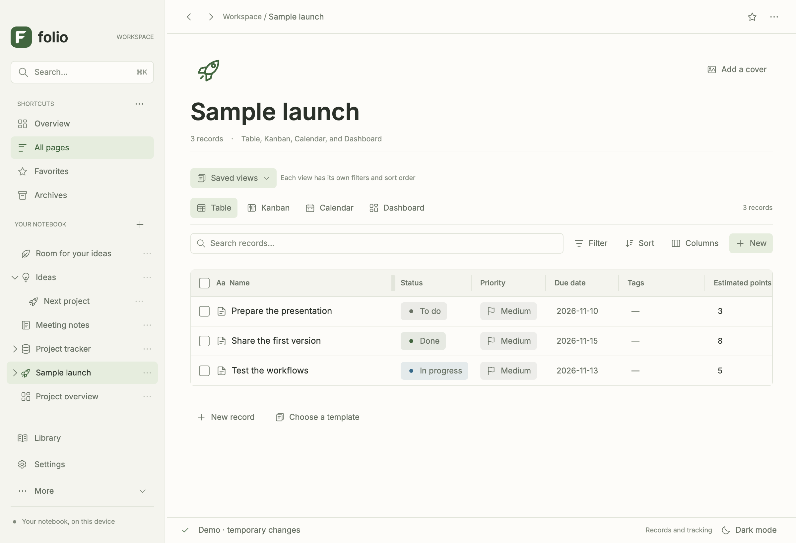

# Folio

[](rust-toolchain.toml)
[](Cargo.toml)
[](CHANGELOG.md)
[](LICENSE)

**A native workspace for notes, tasks, and projects. Built in Rust. Stored locally.**

Folio brings flexible pages, connected notes, and database views to your Mac.
If you like the way Notion organizes information and want a local workspace
without an account or a browser, Folio is built for that workflow.

Write offline, organize projects your way, and keep your notebook on your device.
The next step is optional modules: add the capabilities you need while keeping
the everyday interface focused.

> **Actively developed, early-stage software.** The core workspace is usable today;
> modules are the next development focus. Follow the [changelog](CHANGELOG.md)
> for progress and changes between versions.



## One workspace, several ways to think

| What you want to do | What Folio gives you |
|---|---|
| Write and structure ideas | Rich text, headings, nested lists, tasks, toggles, code, images, and file attachments. Drag blocks to rearrange a page. |
| Organize a project | Collections with table, Kanban, calendar, and dashboard views over the same records. Each record is also a page for notes. |
| Connect your knowledge | Page links, mentions, backlinks, a table of contents, and a global command palette. |
| Build your own workflow | Custom properties, saved views, filters, relations, rollups, and numeric formulas. Embed a collection view inside a note. |
| Make it feel like yours | Light and dark themes, 65 page symbols, eight icon colors, and sidebar shortcuts you can reorder, hide, and restore. |
| Keep control of your work | Page history, checkpoints, complete notebook backups, and Markdown/CSV exports. |

## Local by design

Your notebook lives on your Mac, independently of the application. Writing,
searching, and organizing work offline; no account or hosted service is required.
Templates create pages only when you ask for them. Your edits and deletions
persist across restarts.

Optional notebook encryption uses a master password. Eligible simple notes can
also have their own PIN. Turso's native encryption is still experimental, and
attachments remain separate plaintext files. See the
[security guide](docs/SETTINGS.md) for the scope of protection.

Folio currently focuses on a personal local workspace. Sync, collaboration,
and hosted page sharing are not available.

## Extend your workspace with modules

The goal is to make Folio adaptable without filling the core app with every
specialized feature. Choose an add-on from **Library**, enable it when you need
it, and remove it when your workflow changes.

**The foundation is already in place:** Library manages local module definitions
and catalogs, installation, activation, deactivation, and uninstall. Module state
is isolated and included in notebook backups. Uninstall keeps that state for
reinstallation; deleting it requires confirmation and a verified recovery backup.

**Next:** functional modules, interface extension points, and reviewed package
installation and updates. A planned first add-on will connect development projects
to repositories and reuse Folio's notes, tasks, and Kanban views.

No functional modules or executable module runtime are shipped yet. The online
catalog and add-on distribution are still to come.
[Read about the module foundation](docs/MODULES.md).

## A Rust application from interface to storage

Folio's application stack is written in **Rust**. Rune renders the interface
natively, and Turso stores the notebook in an embedded database.

| Layer | Technology |
|---|---|
| Application and background work | Rust |
| Native interface and rendering | Rune and Rune Kit |
| Embedded local database | Turso |

Rust is pinned in [rust-toolchain.toml](rust-toolchain.toml). Rune and its vendor
patches use an exact Git revision, fetched automatically by Cargo. Turso is pinned
in [Cargo.toml](Cargo.toml), with resolved dependencies in [Cargo.lock](Cargo.lock).
You do not need a separate Rune checkout to build Folio.

## Install Folio as a Mac app

**Supported platform: Apple Silicon, macOS 13 or later.**

Packaged downloads will be available through [GitHub Releases](https://github.com/0xrariux/folio/releases).
There is no downloadable release yet; for now, build the application from source.

On an Apple Silicon Mac with Rust installed through `rustup`, Python 3.11 or
later, and Xcode Command Line Tools:

```sh
git clone https://github.com/0xrariux/folio.git
cd folio
python3 scripts/build-app.py --development --verify-storage
open dist/Folio.app
```

The build downloads the pinned dependencies, runs the production storage checks,
and creates **`dist/Folio.app`**, complete with its icon and a local code signature.
Move it into a writable Applications folder, such as **`~/Applications`**, for
everyday use. You can then launch it from Finder or the Dock without a terminal.

Folio does not use an Apple Developer account. Downloaded builds are ad-hoc signed,
not notarized, so macOS may require explicit approval before opening them.

Your notebook stays in `~/Library/Application Support/Folio/` when you close,
replace, or rebuild the app. `FOLIO_DB_PATH` selects a different profile.
Keep an independent backup; see [storage and recovery](docs/DATA_SAFETY.md).

## Keep the app up to date

Once signed releases are published, updates happen inside Folio:

1. Open **Settings → Check for updates**.
2. Select **Update** when a newer compatible release is available.
3. Select **Install and restart** to back up your notebook and install it.

Folio verifies the signed release and download, creates a verified notebook
backup, and replaces the application bundle. Your data stays in its own folder.
The previous bundle is retained for rollback if the new app fails to start.
An incompatible storage contract blocks automatic installation and requires a
reviewed migration.

Installed users will not need Rust, Git, or a terminal for this process.
A push to the repository alone does not publish an application update.

Until packaged releases are available, refresh a source build with:

```sh
git pull --ff-only
python3 scripts/build-app.py --development --verify-storage
```

Quit Folio, then replace your installed app with the rebuilt `dist/Folio.app`.
Use the `.app` bundle for in-app updates; a raw Cargo executable cannot install
bundle updates. Release preparation and publication are covered in the
[build and update guide](docs/RELEASES.md).

## Explore and contribute

Try fictional sample content without opening your notebook:

```sh
FOLIO_DEMO=1 cargo run --locked -- --scene workspace
```

Demo changes stay in memory and reset on restart. For development, run
`cargo run --locked`. The interface, templates, and documentation are in English.
Feedback, bug reports, and contributions are welcome through
[GitHub Issues](https://github.com/0xrariux/folio/issues) and pull requests.

[User guide](docs/GUIDE.md) · [Feature status](NOTION-PARITY.md) ·
[Settings and security](docs/SETTINGS.md) · [Module API](docs/MODULES.md) ·
[Changelog](CHANGELOG.md)

Folio is open source under the [MIT license](LICENSE).
